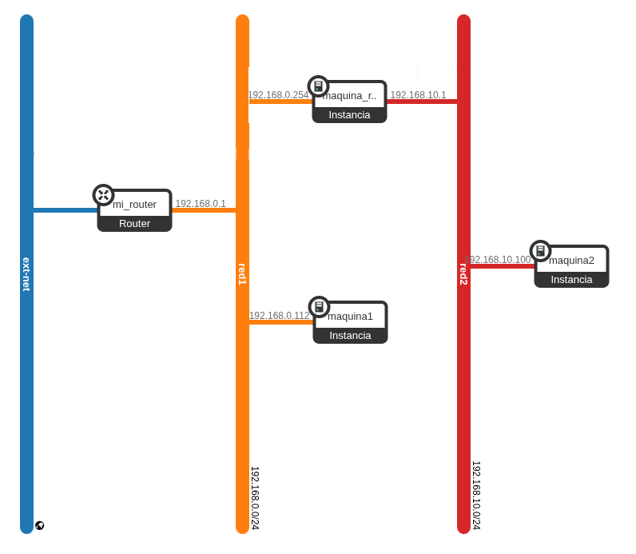

En el ejercicio anterior todas las redes estaban conectadas a un router de OpenStack. En este vas a crear una **red privada aislada** y vas a darle salida a Internet con una **instancia Linux que hace de router**, igual que hiciste con máquinas virtuales y con contenedores en las unidades anteriores.

En OpenStack no es la forma habitual de dar salida a una red (para eso está el router), pero sí es la forma de montar una máquina que procese el tráfico de otras: un cortafuegos, un servidor VPN o un balanceador.

Partimos del final del ejercicio 4: el router `mi_router`, la red `red1` (`192.168.0.0/24`) y la instancia `maquina1`. Este es el escenario que vamos a construir:



## La red privada aislada

Una red privada aislada es una red que no está conectada a ningún router con salida al exterior. Sus instancias:

* **No tienen acceso a Internet**: no hay nadie que haga SNAT.
* **No pueden tener IP flotante**: no hay un router que haga DNAT. Si lo intentamos, OpenStack da un error:

```
$ openstack server add floating ip maquina2 172.22.200.210
... External network ... is not reachable from subnet ... Therefore, cannot associate Port ... with a Floating IP.
```

Se usan para el tráfico que no tiene que salir de la nube: réplica de bases de datos, almacenamiento compartido, comunicación entre los nodos de un clúster…

## Sin DHCP y sin puerta de enlace

La instancia router va a estar conectada a dos redes: `red1` y la red aislada. Si las dos redes le dan una puerta de enlace, la instancia tendrá **dos rutas por defecto** y perderá la conectividad. Por eso creamos la red aislada **sin puerta de enlace** (`--gateway none`) y sin DHCP:

```
openstack network create red2
openstack subnet create --network red2 --no-dhcp --gateway none \
    --subnet-range 192.168.10.0/24 --dns-nameserver 172.22.0.1 subred2
```

En una red sin DHCP:

* **cloud-init configura la interfaz de forma estática**, con la dirección que OpenStack ha asignado al puerto. Lo puedes ver en la configuración de netplan de la instancia.
* El DNS se indica igualmente al crear la subred, para que cloud-init lo configure.

## El config drive

Hay un problema: cloud-init obtiene su configuración del servidor de metadatos **a través de la red**. Una instancia que solo está conectada a una red sin DHCP no tiene red al arrancar, y por tanto no puede leer los metadatos: no sabría su dirección, ni su nombre, ni tendría nuestra clave SSH.

La solución es el **config drive**: OpenStack guarda los metadatos en un CD-ROM virtual conectado a la instancia, y cloud-init los lee de ahí. Se activa con `--config-drive True`:

```
openstack port create --network red2 --fixed-ip ip-address=192.168.10.100 port_maquina2

openstack server create --flavor m1.mini \
    --image "Debian 13 Trixie" \
    --key-name jdmr \
    --port port_maquina2 \
    --config-drive True \
    maquina2
```

:::caution[Ejercicio]
1. Crea la red `red2` con la subred `subred2`: direccionamiento `192.168.10.0/24`, sin DHCP, sin puerta de enlace y con DNS `172.22.0.1`.
2. Crea la instancia `maquina2` en `red2` con la dirección `192.168.10.100`.
3. Intenta asociarle una IP flotante. ¿Qué ocurre? ¿Por qué?
:::

## La instancia router

La instancia que hará de router se conecta a las dos redes. Creamos un puerto en cada una: en `red2` usamos la primera dirección, que será la puerta de enlace de las instancias de esa red.

```
openstack port create --network red1 --fixed-ip ip-address=192.168.0.254 port_red1
openstack port create --network red2 --fixed-ip ip-address=192.168.10.1 port_red2

openstack server create --flavor m1.mini \
    --image "Debian 13 Trixie" \
    --key-name jdmr \
    --port port_red1 \
    --port port_red2 \
    maquina_router
```

Como está conectada a `red1`, que es una red con salida, a esta instancia sí se le puede asociar una IP flotante. Tendrá dos interfaces y una sola ruta por defecto, la de `red1`.

Para entrar en `maquina2` usamos la instancia router como salto:

```
ssh -J debian@<IP flotante de maquina_router> debian@192.168.10.100
```

:::caution[Ejercicio]
1. Crea la instancia `maquina_router` conectada a `red1` (`192.168.0.254`) y a `red2` (`192.168.10.1`), y asóciale una IP flotante. `maquina1` ya no hace falta: puedes eliminarla y reutilizar su IP flotante.
2. Accede a `maquina_router` y comprueba sus interfaces y su tabla de rutas. ¿Cuántas rutas por defecto tiene?
3. Accede a `maquina2` a través de `maquina_router`. Mira su configuración de netplan: ¿cómo se ha configurado la interfaz? ¿Tiene puerta de enlace?
4. Configura `maquina_router` como router de forma **persistente**: activa el reenvío de paquetes y añade la regla de SNAT para la red `192.168.10.0/24`, como hiciste en las unidades anteriores.
5. Como la red no tiene puerta de enlace, configúrala a mano en `maquina2`: añade en su fichero de netplan la ruta por defecto por `192.168.10.1` y aplica la configuración.
6. Comprueba si `maquina2` tiene acceso a Internet. Todavía no debe funcionar.
:::

## La seguridad de los puertos

Aunque el router está bien configurado, `maquina2` sigue sin salida. El motivo está en OpenStack:

* Cada puerto tiene un **cortafuegos**, cuyas reglas son las de sus grupos de seguridad.
* Además de esas reglas, el cortafuegos tiene una protección contra la **suplantación de direcciones** (*anti-spoofing*): solo deja salir de un puerto el tráfico cuya dirección de origen es la IP y la MAC de ese puerto.
* Una instancia que hace de router **reenvía paquetes de otras máquinas**: su origen o su destino no es la IP del puerto por el que pasan. OpenStack lo interpreta como una suplantación y los bloquea.

Para que una instancia pueda enrutar hay que desactivar la **seguridad del puerto** (*port security*). Como un puerto sin seguridad no puede tener grupos de seguridad, se quitan en la misma orden:

```
openstack port set --no-security-group --disable-port-security port_red2
```

Si el puerto no tiene nombre, se indica su identificador (lo puedes ver con `openstack port list --server maquina2`).

Hay que hacerlo en los puertos por los que pasa el tráfico enrutado: los dos de `maquina_router` y el de `maquina2`.

:::note[Nota]
Un puerto sin seguridad no tiene cortafuegos: la instancia queda expuesta y es ella la que tiene que protegerse. Es lo normal en una máquina que hace de router o de cortafuegos.
:::

:::caution[Ejercicio]
1. Desactiva la seguridad en los dos puertos de `maquina_router` y en el puerto de `maquina2`.
2. Comprueba que `maquina2` tiene ahora acceso a Internet y que resuelve nombres.
3. Reinicia `maquina_router` y `maquina2` y comprueba que todo sigue funcionando.
4. Mira la Topología de red en Horizon.
5. Elimina toda la infraestructura que has creado en los ejercicios 4 y 5, en el orden correcto: instancias, puertos, redes y router.
:::

:::tip[Entrega]
Lo que tienes que entregar de este ejercicio en la [Tarea 3.1](../tarea1/):

1. Las instrucciones para crear la red aislada, los puertos y las dos instancias.
2. La configuración de `maquina_router` como router: reenvío de paquetes y regla de SNAT.
3. El fichero de netplan de `maquina2` con la puerta de enlace.
4. Las instrucciones para desactivar la seguridad de los puertos.
5. Una captura de la Topología de red de Horizon.
6. Una captura en `maquina2` donde se vea su tabla de rutas y que tiene acceso a Internet usando un nombre de dominio.
7. Responde: ¿por qué `maquina2` no tiene acceso a Internet hasta que se desactiva la seguridad de los puertos, si el router está bien configurado?
:::
