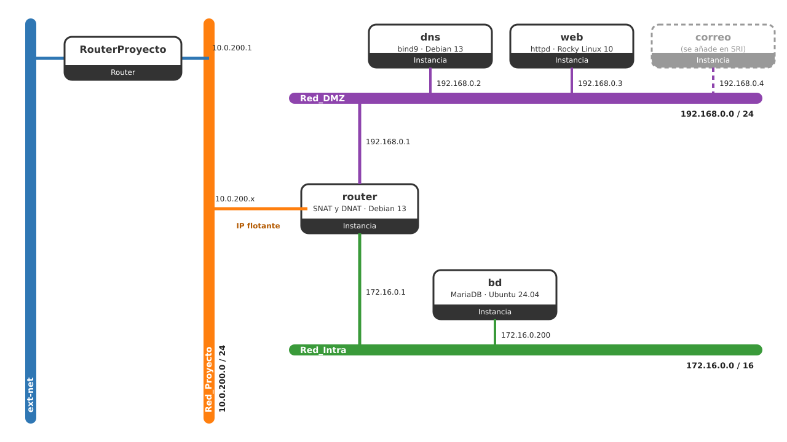

En esta práctica vas a construir, con OpenStack, el escenario de red de una pequeña organización: un **router Linux** que protege tres redes, dos servidores accesibles desde Internet (en una **DMZ**) y una base de datos que solo se alcanza desde la DMZ (en una **red interna**). Este escenario lo vas a reutilizar en el módulo de **Servicios de Red e Internet**, donde instalarás el servidor DNS y el servidor de correo.

La práctica **se hace poco a poco**: cada fase indica después de qué ejercicio puedes empezar a hacerla. No esperes al final de la unidad.

## El escenario

Los nombres de las máquinas son provisionales: los elegiremos entre todos en clase. Mientras tanto usamos el papel que juega cada una.

| Máquina | Sistema | Red | IP | Papel |
|:--|:--|:--|:--|:--|
| `router` | Debian 13, sobre un volumen de 15 GB | `Red_Proyecto`, `Red_DMZ` y `Red_Intra` | `Red_DMZ`: `192.168.0.1` `Red_Intra`: `172.16.0.1` | Router, SNAT, DNAT y cortafuegos. Tiene la IP flotante |
| `dns` | Debian 13 | `Red_DMZ` | `192.168.0.2` | Servidor DNS (se instala en SRI) |
| `web` | Rocky Linux 9, sobre un volumen de 15 GB | `Red_DMZ` | `192.168.0.3` | Servidor web (`httpd`) |
| `bd` | Ubuntu 24.04 | `Red_Intra` | `172.16.0.200` | Servidor de base de datos (MariaDB) |

La dirección `192.168.0.4` queda **reservada** para el servidor de correo, que añadirás en SRI.

El dominio de las máquinas será `tunombre.gonzalonazareno.org`: por ejemplo, `router.tunombre.gonzalonazareno.org`. **`tunombre` no puede coincidir con tu usuario de OpenStack**: OpenStack ya usa ese nombre para su propio DNS (**Designate**), que no tiene ninguna relación con el servidor DNS que montarás en SRI.

## Normas

* Todas las operaciones sobre recursos de OpenStack tienes que hacerlas con **OSC**. Horizon solo lo puedes usar para comprobar el resultado y para las capturas de la Topología de red.
* Los recursos que creas en los ejercicios son de prueba y usan otros nombres. **Elimínalos al terminar cada ejercicio**, y siempre antes de crear las redes de la fase 4, que reutilizan algunos de sus direccionamientos.
* Todas las instancias tendrán dos usuarios: un usuario sin privilegios (con el nombre que quieras, **el mismo en todas**, al que accedes con tu clave SSH) y un usuario `profesor`, que puede usar `sudo` sin contraseña. Copia mi clave pública en el usuario `profesor`.
* **No elimines el escenario cuando termines la práctica**: lo vas a necesitar en SRI.

## Fase 1: Plantilla de cloud-init

*Después del ejercicio 2.*

Prepara un fichero `cloud-config.yaml` que sirva para **todas** las instancias, cambiando solo el nombre. Debe:

* Actualizar los paquetes de la distribución.
* Configurar el nombre (`hostname`) y el FQDN, con el dominio `tunombre.gonzalonazareno.org`.
* Crear el usuario sin privilegios y el usuario `profesor`, como se indica en las normas.
* Cambiar la contraseña del usuario `root`.

Comprueba qué cambia en Rocky Linux respecto a Debian (por ejemplo, el usuario que crea la imagen por defecto o el gestor de paquetes) y adapta la plantilla si es necesario.

Puedes generar y validar el fichero con **openINIT**, un formulario web que produce el `cloud-config` y avisa de los errores: [openinit.josedomingo.org](https://openinit.josedomingo.org) (elige «Para: OpenStack»).

En **Ejemplos…** tienes uno llamado **«Teclado en español y caché de paquetes del aula»**: deja la consola de Horizon con el teclado en español y las instalaciones de paquetes usando la caché del aula (cada paquete se descarga una sola vez para todas las máquinas), así que va muy bien como punto de partida para tu plantilla. Fíjate en lo que hace, porque pone una contraseña a `root` que tienes que cambiar.

:::tip[Entrega]
1. El fichero `cloud-config.yaml` base y los cambios que has necesitado para cada sistema.
:::

## Fase 2: Volúmenes

*Después del ejercicio 3.*

Crea los dos volúmenes arrancables de 15 GB a partir de imágenes:

* Uno con **Debian 13**, para `router`.
* Uno con **Rocky Linux 9**, para `web`.

`dns` y `bd` no usan volumen: se crean con un sabor `m1`. Las instancias con volumen usan un sabor `vol.medium`.

:::tip[Entrega]
1. Las instrucciones para crear los volúmenes.
:::

## Fase 3: La red con salida

*Después del ejercicio 4.*

Los proyectos de OpenStack ya traen un router y una red. **No los uses**: vas a crear los tuyos.

* Crea un **nuevo** router llamado **RouterProyecto**, conectado a la red externa.
* Crea una red **Red_Proyecto**, conectada a ese router, con estas características:
    * Direccionamiento: `10.0.200.0/24`.
    * Con DHCP y DNS `172.22.0.1`.
    * La puerta de enlace es `10.0.200.1`.

Esta es la red por la que `router` sale a Internet y recibe su IP flotante.

:::tip[Entrega]
1. Las instrucciones para crear el router y la red.
2. Una captura de la Topología de red de Horizon.
:::

## Fase 4: El router Linux

*Después del ejercicio 5.*

### Las redes aisladas

Crea las dos redes que no tienen salida por sí mismas:

* **Red_DMZ**: `192.168.0.0/24`.
* **Red_Intra**: `172.16.0.0/16`.

Las dos **sin DHCP** y **sin puerta de enlace** (para que cloud-init no configure dos rutas por defecto en `router`), y con DNS `172.22.0.1`.

### La instancia `router`

Crea la instancia `router` sobre el volumen de Debian, con tu plantilla de cloud-init y un sabor `vol.medium`. Tiene tres interfaces:

* `Red_Proyecto`: una dirección cualquiera, por DHCP.
* `Red_DMZ`: `192.168.0.1`.
* `Red_Intra`: `172.16.0.1`.

Asóciale una **IP flotante**. Desactiva la **seguridad de los puertos** (y los grupos de seguridad) en sus tres puertos.

### Configuración del router

Configura `router` de forma **permanente**:

* El reenvío de paquetes.
* Una regla de **SNAT** para que las máquinas de `Red_DMZ` y de `Red_Intra` tengan acceso a Internet.
* Un **cortafuegos mínimo** para el propio router: política por defecto restrictiva y solo permite el acceso por SSH (además de las conexiones ya establecidas y de ICMP).

:::tip[Entrega]
1. Las instrucciones para crear las redes y la instancia.
2. La IP flotante de `router`.
3. La configuración permanente del reenvío, el SNAT y el cortafuegos.
4. Una captura de la Topología de red de Horizon.
:::

## Fase 5: Los servidores

*Cuando `router` ya tenga salida a Internet.*

**Importante**: crea las demás instancias **después** de que `router` esté funcionando. Su cloud-init actualiza e instala paquetes, y para eso necesitan acceso a Internet a través de `router`.

### Grupos de seguridad

Antes de crear las instancias, crea **un grupo de seguridad por función**. Cada instancia usará solo el suyo (no el grupo `default`):

| Grupo | Para | Reglas de entrada |
|:--|:--|:--|
| `sg_dns` | `dns` | SSH e ICMP desde `192.168.0.0/24` |
| `sg_web` | `web` | SSH e ICMP desde `192.168.0.0/24`; HTTP (puerto 80) desde cualquier origen |
| `sg_bd` | `bd` | SSH e ICMP desde `172.16.0.0/16`; MariaDB (puerto 3306) desde `192.168.0.0/24` |

Piensa por qué los orígenes son distintos: a las máquinas de la DMZ se entra desde `router` (`192.168.0.1`), y a `bd` desde su interfaz de `Red_Intra` (`172.16.0.1`), mientras que a la base de datos solo conectan las máquinas de la DMZ. El puerto del servidor DNS lo abrirás en el módulo de SRI.

Como las instancias usan puertos que creas tú con una dirección fija, el grupo de seguridad se indica **al crear el puerto** (`--security-group`), porque pertenece al puerto y no a la instancia.

Como las redes no tienen DHCP, las instancias necesitan el **config drive**, y como no tienen puerta de enlace, tendrás que configurarla tú dentro de cada máquina, de forma permanente. Investiga cómo se hace en cada sistema (en Debian y en Ubuntu se usa netplan; en Rocky Linux, NetworkManager). La puerta de enlace es `192.168.0.1` para las máquinas de la DMZ y `172.16.0.1` para las de la red interna.

### `dns`

* Debian 13, con un sabor `m1` y el grupo `sg_dns`, conectada a `Red_DMZ` con la dirección `192.168.0.2`.
* Por ahora solo la dejas preparada: el servidor DNS (bind9) lo instalarás en SRI.

### `web`

* Rocky Linux 9 sobre el volumen de la fase 2, con un sabor `vol.medium` y el grupo `sg_web`, conectada a `Red_DMZ` con la dirección `192.168.0.3`.
* Instala el servidor web `httpd` y publica una página de prueba.
* **Mantén SELinux y firewalld activados.** Para que la página se sirva tienes que abrir el puerto en firewalld.

### `bd`

* Ubuntu 24.04, con un sabor `m1` y el grupo `sg_bd`, conectada a `Red_Intra` con la dirección `172.16.0.200`.
* Instala MariaDB, que debe escuchar solo en su dirección de `Red_Intra`.
* Crea una base de datos y un usuario al que se le permita conectar desde la red `192.168.0.0/24`.

### Comprobaciones

* Las tres máquinas tienen el FQDN bien configurado y acceso a Internet por nombre de dominio.
* Puedes acceder por SSH a todas ellas. A las que no tienen IP flotante se accede a través de `router`.
* Desde `router`, la página de `web` se ve con `curl`.

:::tip[Entrega]
1. Las instrucciones para crear los grupos de seguridad y sus reglas.
2. Las instrucciones para crear las instancias y los puertos.
3. Los ficheros `cloud-config.yaml` que has usado.
4. La configuración de red permanente de `dns` y de `web`.
5. Prueba de que los FQDN son correctos en las cuatro máquinas.
6. Prueba de que se accede por SSH a las cuatro máquinas, y cómo lo haces.
7. Prueba de que las tres máquinas tienen acceso a Internet usando un nombre de dominio.
8. En `web`: la salida de `getenforce` y `firewall-cmd --list-all`, y una captura de la página de prueba obtenida desde `router`.
9. Una captura de la Topología de red de Horizon.
:::

## Fase 6: Comprobar las capas

*Cuando estén las cuatro máquinas.*

La red interna debe ser **realmente interna**: solo la DMZ puede llegar a la base de datos. Añade en `router`, de forma permanente, las reglas de reenvío necesarias para que:

* Las máquinas de `Red_DMZ` puedan conectar a `bd` **solo por el puerto de MariaDB**.
* `bd` no pueda iniciar conexiones hacia la DMZ.
* Las máquinas de las dos redes sigan teniendo acceso a Internet.

Para comprobarlo, instala el cliente de MariaDB en `dns` y conecta con la base de datos.

:::tip[Entrega]
1. Las reglas del cortafuegos de `router`.
2. Una captura de la conexión a la base de datos desde `dns`.
3. Una prueba de que no se puede conectar a `bd` desde fuera ni intentando otro puerto.
:::

## Fase 7: Cierre del escenario

Este escenario es la base de las prácticas de SRI, así que déjalo preparado:

* Crea una **instantánea** de los dos volúmenes (`router` y `web`) y de las instancias `dns` y `bd`. Es tu punto de restauración.
* Anota en una tabla los nombres, las direcciones y los sistemas de las cuatro máquinas, y la dirección `192.168.0.4` reservada para el correo.

:::tip[Entrega]
1. La salida de los comandos que muestran las instantáneas.
2. La tabla con el resumen del escenario.
:::
