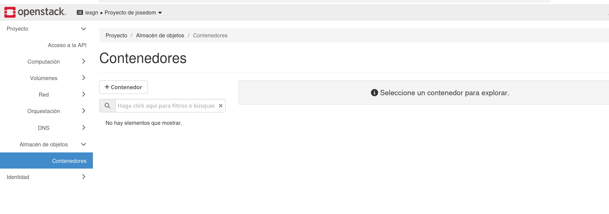

En este ejercicio vas a trabajar con **OpenStack Swift**, el servicio de almacenamiento de objetos de la nube del instituto (`openstack.gonzalonazareno.org`). Vas a guardar, consultar y borrar objetos de **tres formas distintas**:

1. Con **Horizon**, la interfaz web de OpenStack.
2. Con el cliente de línea de comandos **`openstack`**.
3. Con **`curl`**, haciendo **a mano** las peticiones HTTP a la API REST de Swift.

Al terminar verás que las tres formas hacen **exactamente lo mismo**: todas envían peticiones HTTP a la API de Swift. Lo único que cambia es quién construye esas peticiones: Horizon, el cliente `openstack` o tú.

Recuerda los conceptos de la presentación:

* Un **objeto** son unos datos (el contenido de un fichero) con sus **metadatos** y un **nombre** que lo identifica.
* Los objetos se guardan en **contenedores**. Los contenedores no se pueden anidar.
* Cada proyecto de OpenStack tiene una **cuenta** en Swift, con sus contenedores.
* Cada objeto tiene su propia **URL**: `https://openstack.gonzalonazareno.org/swift/v1/AUTH_<proyecto>/<contenedor>/<objeto>`.

## Parte 1: Swift desde Horizon

### 1.1. Accede al almacén de objetos

Entra en Horizon con tu usuario y ve a **Proyecto → Almacén de objetos → Contenedores**. Al principio no tendrás ningún contenedor:



### 1.2. Crea un contenedor

Pulsa **+ Contenedor**. Escribe como nombre `web`, deja la política de almacenamiento por defecto y deja el acceso como **no público**. Pulsa **Enviar**.

El contenedor aparece en la lista de la izquierda. Púlsalo: a la derecha verás su contenido (todavía vacío) y, al desplegar su información, el número de objetos, el tamaño y la fecha de creación.

### 1.3. Sube un objeto

Con el contenedor `web` seleccionado, pulsa el botón de **subir fichero** (el icono de la flecha hacia arriba) y elige una imagen de tu equipo. Ponle de nombre `logo.png` y súbela.

El fichero que has subido ya es un **objeto** dentro del contenedor `web`.

### 1.4. Las carpetas no existen

Pulsa **+ Carpeta** y crea una carpeta llamada `img`. Entra en ella y sube otra imagen, por ejemplo `foto.png`.

Parece que tienes una carpeta con un fichero dentro, como en tu disco. Pero en el almacenamiento de objetos el espacio de nombres es **plano**: lo que hay realmente en el contenedor es un objeto llamado **`img/foto.png`**. Horizon agrupa los objetos cuyo nombre empieza por `img/` y te los muestra como si fuera una carpeta. Lo comprobarás en la parte 2, cuando listes los objetos desde la línea de comandos.

### 1.5. Consulta los metadatos de un objeto

Vuelve a la raíz del contenedor. En la fila de `logo.png`, despliega el menú de acciones y elige **Ver detalles**. Verás los **metadatos** del objeto:

* El **tamaño** en bytes.
* El **tipo de contenido** (`image/png`).
* La **fecha** de la última modificación.
* El **hash** del contenido.

Estos metadatos se guardan **junto al objeto**. Swift no necesita abrir la imagen para saber qué es o cuánto ocupa.

### 1.6. Haz público el contenedor

Por defecto, todo lo que guardas en Swift es **privado**: solo pueden verlo los usuarios de tu proyecto.

Despliega la información del contenedor `web` y marca la casilla **Acceso público**. Al hacerlo, aparece un **enlace** al contenedor, parecido a este:

```
https://openstack.gonzalonazareno.org/swift/v1/AUTH_1a2b3c.../web
```

Fíjate en las partes de la URL: el **servicio** (`.../swift/v1`), tu **cuenta** (`AUTH_` seguido del identificador de tu proyecto) y el **contenedor** (`web`). Para obtener la URL de un objeto, basta con añadir su nombre al final:

```
https://openstack.gonzalonazareno.org/swift/v1/AUTH_1a2b3c.../web/logo.png
```

Abre una **ventana privada** del navegador (para no tener la sesión de Horizon iniciada) y pega la URL de `logo.png`. Verás la imagen. Prueba también con la URL de `img/foto.png`.

Esa URL ya se podría poner en una página web: ``.

### 1.7. Vuelve a hacerlo privado

Desmarca la casilla **Acceso público** y recarga la URL en la ventana privada. Ahora el servidor te contesta con un error **401 Unauthorized**: para acceder a un contenedor privado hay que identificarse.

:::tip[Piénsalo]
* ¿Existe realmente la carpeta `img`? ¿Cuál es el nombre completo del segundo objeto que subiste?
* Al abrir la URL en el navegador, ¿qué método HTTP ha usado el navegador?
:::

## Parte 2: Swift con el cliente `openstack`

### 2.1. Instala el cliente

Puedes instalarlo con `apt`:

```bash
sudo apt install python3-openstackclient
```

O, si prefieres, en un entorno virtual de Python:

```bash
python3 -m venv os
source os/bin/activate
pip install python-openstackclient
```

### 2.2. Descarga el fichero de credenciales

Para usar el cliente, este tiene que saber **a qué nube** conectarse, **con qué usuario** y **en qué proyecto**. Toda esa información está en el **fichero de credenciales** (*OpenStack RC*), que se descarga desde Horizon:

* En el menú de la izquierda, **Proyecto → Acceso a la API**.
* Pulsa **Descargar fichero RC de OpenStack → Fichero OpenStack RC**.

Se descarga un fichero con un nombre parecido a `Proyecto de usuario-openrc.sh`. Ábrelo con un editor y mira lo que contiene: es un pequeño *script* que define unas **variables de entorno**. Fíjate en que **no guarda tu contraseña**: te la pedirá al cargarlo.

### 2.3. Carga las credenciales

Para que las variables se definan en tu terminal, hay que **cargar** el fichero con `source` (las comillas son necesarias porque el nombre tiene espacios). Escribe tu contraseña de OpenStack cuando te la pida:

```bash
source "Proyecto de usuario-openrc.sh"
Please enter your OpenStack Password for project Proyecto de usuario as user usuario:
```

Comprueba las variables que se han definido:

```bash
env | grep OS_
```

Las más importantes son:

| Variable | Contenido |
|:--|:--|
| `OS_AUTH_URL` | URL de **Keystone**, el servicio de identidad de OpenStack |
| `OS_USERNAME` | Tu usuario |
| `OS_PASSWORD` | Tu contraseña (la que acabas de escribir) |
| `OS_PROJECT_ID` | El identificador de tu proyecto |
| `OS_PROJECT_NAME` | El nombre de tu proyecto |

:::note
Las variables solo existen en el terminal donde has hecho el `source`. Si abres otro terminal, tienes que volver a cargar el fichero.
:::

Con las credenciales cargadas ya puedes usar el cliente `openstack`.

### 2.4. Consulta tus contenedores

Lista tus contenedores:

```bash
openstack container list
```

Aparecerá el contenedor `web` que creaste con Horizon. Lista los objetos que tiene:

```bash
openstack object list web
```

Fíjate en que aparece el objeto **`img/foto.png`**: un único objeto con una barra en el nombre, no una carpeta. También aparece un objeto llamado **`img/`**: es un objeto **vacío** que Horizon creó al pulsar **+ Carpeta**, solo para poder mostrarte la carpeta aunque esté vacía.

### 2.5. Crea un contenedor y sube objetos

Crea un contenedor llamado `documentos`:

```bash
openstack container create documentos
```

Crea un fichero de texto y súbelo al contenedor. El objeto se llama igual que el fichero:

```bash
echo "Hola desde Swift" > saludo.txt
openstack object create documentos saludo.txt
```

Sube el mismo fichero con **otro nombre**, que contenga barras:

```bash
openstack object create --name textos/2026/saludo.txt documentos saludo.txt
```

Lista los objetos del contenedor. Después lista solo los que empiezan por `textos/`, usando un **prefijo**:

```bash
openstack object list documentos
openstack object list --prefix textos/ documentos
```

Así es como se simulan las carpetas: buscando los objetos que empiezan por un prefijo.

### 2.6. Consulta y añade metadatos

Muestra la información del objeto `saludo.txt`:

```bash
openstack object show documentos saludo.txt
```

Verás el tamaño (`content-length`), el tipo (`content-type`), la fecha (`last-modified`) y el **`etag`**. El ETag es el **hash MD5** del contenido del objeto. Calcula el MD5 del fichero de tu equipo y compáralo:

```bash
md5sum saludo.txt
```

Coinciden. Gracias a esto se puede comprobar que el objeto se ha subido (o descargado) **sin errores**.

Además de los metadatos que pone Swift, puedes añadir **metadatos propios**. Añade uno con tu nombre y comprueba que aparece en el campo `properties`:

```bash
openstack object set --property autor=Pepe documentos saludo.txt
openstack object show documentos saludo.txt
```

### 2.7. Descarga un objeto

Borra el fichero de tu equipo y descarga el objeto:

```bash
rm saludo.txt
openstack object save documentos saludo.txt
cat saludo.txt
```

### 2.8. Borra objetos y contenedores

Intenta borrar el contenedor `documentos`:

```bash
openstack container delete documentos
```

Obtendrás un error: un contenedor **no se puede borrar si tiene objetos**. Puedes borrar los objetos uno a uno con `openstack object delete`, o borrar el contenedor con todo su contenido con `--recursive`:

```bash
openstack container delete --recursive documentos
```

:::tip[Piénsalo]
* ¿Qué ventaja tiene el ETag? ¿Cuándo te serviría?
:::

## Parte 3: La API REST con `curl`

En esta parte vas a hacer tú las peticiones HTTP a la API de Swift. En cada petición indicarás:

* **Qué recurso** quieres usar, con la **URL** (la cuenta, un contenedor o un objeto).
* **Qué operación** quieres hacer, con el **método HTTP** (`GET`, `HEAD`, `PUT`, `POST` o `DELETE`).
* **Quién eres**, con el **token** en la cabecera `X-Auth-Token`.

Y sabrás si ha ido bien por el **código de estado** de la respuesta.

Recuerda las opciones de `curl` que vas a usar: `-i` muestra las cabeceras de la respuesta, `-I` hace una petición `HEAD`, `-X` indica el método, `-H` añade una cabecera y `-T` envía un fichero en el cuerpo de la petición.

### 3.1. Pide un token

Como vimos en la presentación, en la API de Swift no se envían el usuario y la contraseña en cada petición. Primero se pide un **token** a **Keystone**, el servicio de identidad, y después se envía ese token en cada petición.

El cliente `openstack` lo hacía por ti de forma automática cada vez que lo usabas. Ahora tienes que pedirlo tú. Con el fichero de credenciales cargado, ejecuta:

```bash
openstack token issue
```

Verás algo parecido a esto:

```
+------------+-----------------------------------------+
| Field      | Value                                   |
+------------+-----------------------------------------+
| expires    | 2026-11-04T10:15:02+0000                |
| id         | gAAAAABpKx3f...                         |
| project_id | 1a2b3c...                               |
| user_id    | 9f8e7d...                               |
+------------+-----------------------------------------+
```

El campo `id` es el token. Fíjate en `expires`: el token **caduca** pasado un tiempo. Para no tener que copiarlo a mano, guárdalo en la variable `TOKEN`:

```bash
TOKEN=$(openstack token issue -f value -c id)
echo $TOKEN
```

### 3.2. Prepara la URL de tu cuenta

Guarda en la variable `URL` la dirección de tu **cuenta** de Swift. Es la URL del servicio seguida de `AUTH_` y el identificador de tu proyecto:

```bash
URL=https://openstack.gonzalonazareno.org/swift/v1/AUTH_$OS_PROJECT_ID
echo $URL
```

Comprueba que coincide con el enlace que te mostró Horizon en el paso 1.6.

:::caution
Si tu token caduca, las peticiones empezarán a devolver **401**. Vuelve a ejecutar `TOKEN=$(openstack token issue -f value -c id)` para obtener otro.
:::

### 3.3. Consulta tu cuenta (`HEAD`)

Con una petición `HEAD` obtienes los **metadatos** de tu cuenta, sin cuerpo:

```bash
curl -I -H "X-Auth-Token: $TOKEN" $URL
```

```
HTTP/1.1 204 No Content
X-Account-Container-Count: 1
X-Account-Object-Count: 3
X-Account-Bytes-Used: 52832
...
```

Los metadatos viajan en las **cabeceras** de la respuesta: el número de contenedores, de objetos y los bytes usados (tus números serán distintos). El código **204 No Content** indica que la petición ha ido bien y que la respuesta no tiene cuerpo.

### 3.4. Lista los contenedores (`GET`)

Con una petición `GET` a la cuenta obtienes la lista de contenedores:

```bash
curl -i -H "X-Auth-Token: $TOKEN" $URL
```

Ahora el código es **200 OK** y la lista viene en el **cuerpo**, un contenedor por línea. Pídela en formato JSON, que es como la piden las aplicaciones porque incluye más información y es fácil de procesar:

```bash
curl -H "X-Auth-Token: $TOKEN" "$URL?format=json"
```

### 3.5. Crea un contenedor (`PUT`)

Para crear un contenedor se usa el método **`PUT`** sobre la URL que tendrá el contenedor:

```bash
curl -i -X PUT -H "X-Auth-Token: $TOKEN" $URL/api
```

La respuesta es **201 Created**: se ha creado un recurso nuevo.

### 3.6. Sube un objeto (`PUT`)

Para subir un objeto también se usa **`PUT`**, sobre la URL que tendrá el objeto, enviando el fichero en el cuerpo de la petición:

```bash
echo "<h1>Hola desde Swift</h1>" > index.html
curl -i -X PUT -H "X-Auth-Token: $TOKEN" -T index.html $URL/api/index.html
```

La respuesta es otra vez **201 Created**. Fíjate en la cabecera **`Etag`**: compárala con el resultado de `md5sum index.html`.

### 3.7. Lista los objetos y consulta sus metadatos

Lista los objetos del contenedor con `GET`:

```bash
curl -i -H "X-Auth-Token: $TOKEN" $URL/api
```

Consulta los metadatos del objeto con `HEAD`:

```bash
curl -I -H "X-Auth-Token: $TOKEN" $URL/api/index.html
```

Fíjate en las cabeceras `Content-Length`, `Content-Type`, `Etag` y `Last-Modified`. El `Content-Type` es `text/html`: como `curl` no lo ha indicado al subir el fichero, Swift lo ha **deducido por la extensión** del nombre.

### 3.8. Descarga el objeto (`GET`)

```bash
curl -H "X-Auth-Token: $TOKEN" $URL/api/index.html
```

El contenido del objeto viene en el **cuerpo** de la respuesta.

### 3.9. Añade metadatos (`POST`)

Para modificar los metadatos de un objeto se usa **`POST`**. Los metadatos propios se envían en cabeceras que empiezan por `X-Object-Meta-`:

```bash
curl -i -X POST -H "X-Auth-Token: $TOKEN" -H "X-Object-Meta-Autor: Pepe" $URL/api/index.html
```

La respuesta es **202 Accepted**. Vuelve a hacer la petición `HEAD` del paso 3.7 y comprueba que aparece la cabecera `X-Object-Meta-Autor`.

### 3.10. Sin token no hay acceso

Intenta descargar el objeto **sin enviar el token**:

```bash
curl -i $URL/api/index.html
```

La respuesta es **401 Unauthorized**: no te has identificado. Prueba ahora con un token inventado:

```bash
curl -i -H "X-Auth-Token: tokenfalso" $URL/api/index.html
```

También obtienes **401**: el token no es válido.

### 3.11. Haz público el contenedor (`POST`)

Para hacer público un contenedor, se le asigna una **ACL de lectura**. Se hace con una petición `POST` al contenedor, con la cabecera `X-Container-Read`. El valor `.r:*` significa «cualquiera puede leer los objetos»:

```bash
curl -i -X POST -H "X-Auth-Token: $TOKEN" -H "X-Container-Read: .r:*" $URL/api
```

La respuesta es **204 No Content**: ha ido bien y no hay nada que devolver. Ahora descarga el objeto **sin token**:

```bash
curl -i $URL/api/index.html
```

Ahora sí: **200 OK**. Abre también la URL del objeto en el navegador. Es lo mismo que hiciste en el paso 1.6 marcando la casilla **Acceso público** en Horizon.

Pero la ACL `.r:*` solo permite **leer objetos**. Sin token, intenta **listar** el contenedor y **borrar** el objeto:

```bash
curl -i $URL/api
curl -i -X DELETE $URL/api/index.html
```

Las dos peticiones se rechazan: cualquiera puede descargar un objeto si conoce su URL, pero para listar el contenido o modificarlo sigue haciendo falta identificarse.

### 3.12. Borra el objeto y el contenedor (`DELETE`)

Intenta borrar el contenedor:

```bash
curl -i -X DELETE -H "X-Auth-Token: $TOKEN" $URL/api
```

La respuesta es **409 Conflict**: el contenedor no está vacío. Es el mismo error que te dio el cliente `openstack` en el paso 2.8. Borra primero el objeto y después el contenedor:

```bash
curl -i -X DELETE -H "X-Auth-Token: $TOKEN" $URL/api/index.html
curl -i -X DELETE -H "X-Auth-Token: $TOKEN" $URL/api
```

Las dos responden **204 No Content**. Por último, intenta descargar de nuevo el objeto:

```bash
curl -i -H "X-Auth-Token: $TOKEN" $URL/api/index.html
```

Obtienes **404 Not Found**: el recurso ya no existe.

## Resumen: tres formas, una misma API

| Operación | Horizon | `openstack` | Petición HTTP |
|:--|:--|:--|:--|
| Crear un contenedor | **+ Contenedor** | `openstack container create` | `PUT /<cont>` → 201 |
| Subir un objeto | Subir fichero | `openstack object create` | `PUT /<cont>/<obj>` → 201 |
| Listar objetos | Pulsar el contenedor | `openstack object list` | `GET /<cont>` → 200 |
| Ver metadatos | Ver detalles | `openstack object show` | `HEAD /<cont>/<obj>` → 200 |
| Añadir metadatos | — | `openstack object set` | `POST /<cont>/<obj>` → 202 |
| Descargar | Descargar | `openstack object save` | `GET /<cont>/<obj>` → 200 |
| Hacer público | Casilla **Acceso público** | — | `POST /<cont>` con `X-Container-Read: .r:*` → 204 |
| Borrar | Eliminar | `openstack object delete` / `container delete` | `DELETE` → 204 (409 si el contenedor no está vacío) |

Para terminar, borra el contenedor `web` que creaste en la parte 1:

```bash
openstack container delete --recursive web
```

:::tip[Piénsalo]
* ¿Qué tienen en común Horizon, el cliente `openstack` y `curl`?
* En la API, ¿cómo se indica el recurso, cómo se indica la operación y cómo se sabe el resultado?
* ¿Por qué hay que enviar el token en **todas** las peticiones? ¿Qué tiene que ver con que HTTP sea *stateless*?
* ¿Qué códigos de estado has obtenido a lo largo del ejercicio? ¿Qué significa cada uno?
:::
